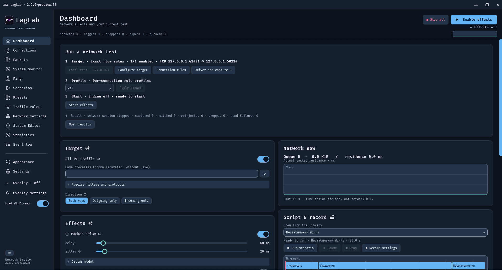
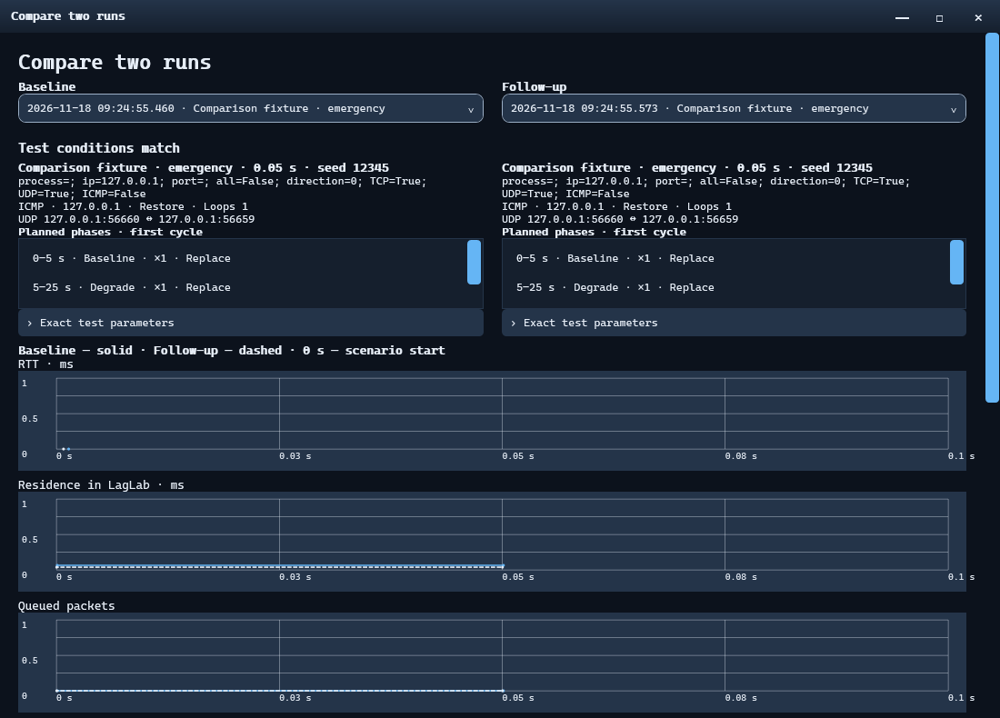
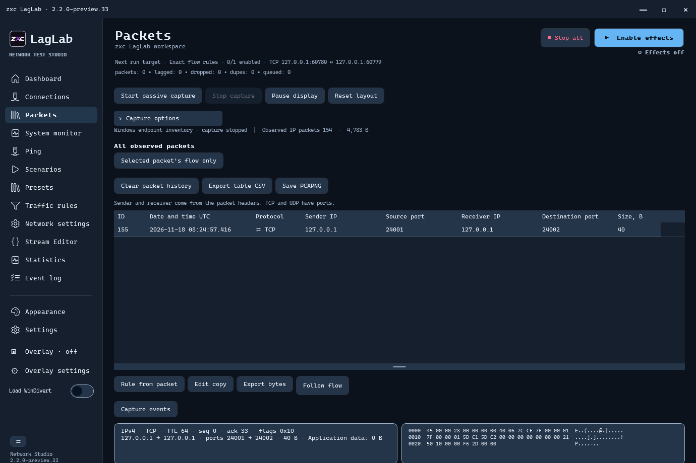
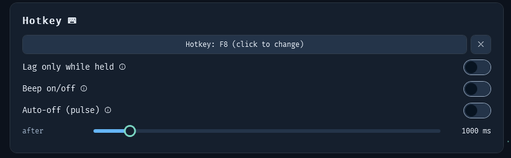

# ZxcLagLab

What happens to your app when latency spikes or packets start dropping? ZxcLagLab lets you reproduce those conditions on Windows and compare two runs side by side.

[Download the Windows x64 public beta](https://github.com/triple6xseven/zxc/releases/tag/v2.2.0-preview.34)

Choose a target, apply a preset, and start the test. Add latency, jitter, packet loss, or a bandwidth cap. For repeatable tests, build a scenario with timed phases and compare the results on a shared timeline.

Inspect connections and packets, make rules for individual flows, and export captures as PCAPNG. You can also toggle effects with a hotkey or apply them only while the key is held.

More screenshots

Found a bug or have an idea? [Open an issue](https://github.com/triple6xseven/zxc/issues).

The beta is free. If you want to support development toward the full release, the Bitcoin (BTC) address is `bc1qccr4u54zen9hqla573kxayy5mm58l96gnnkdey`.
