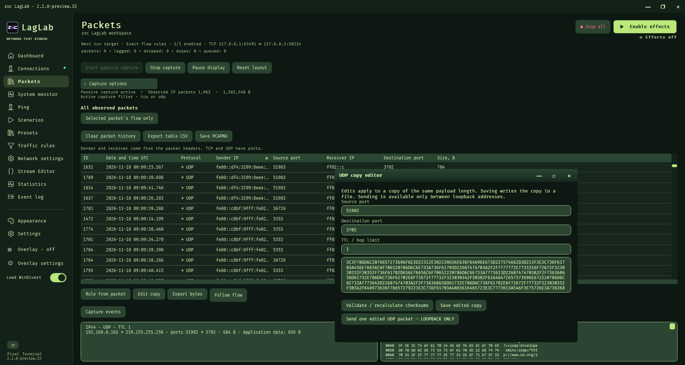
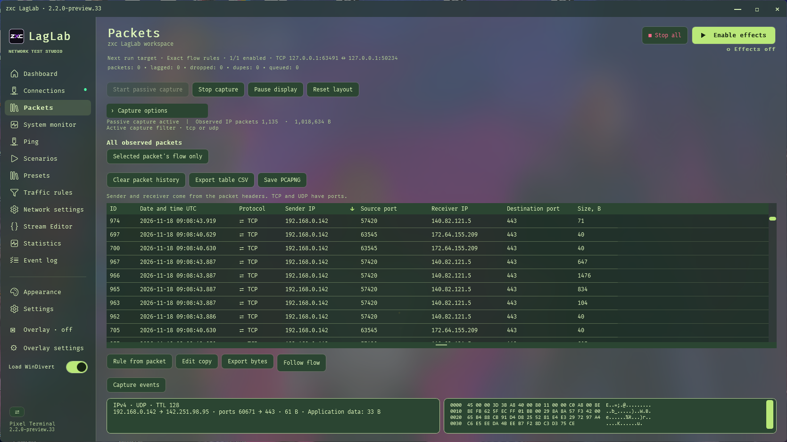
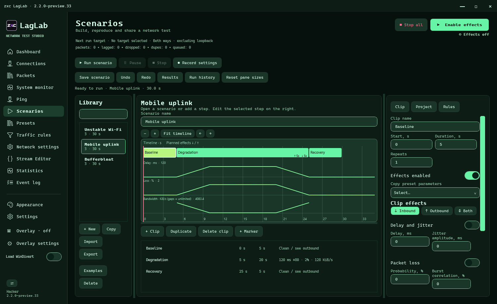
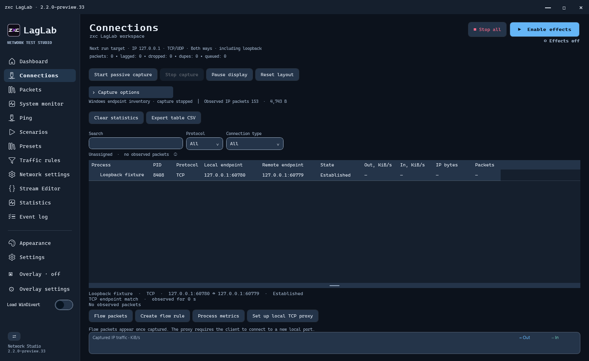

# ZxcLagLab

ZxcLagLab is a Windows network testing tool. It lets you see what happens when an app loses packets, gets a burst of latency, or has to recover on a slow connection. You can reproduce those conditions, inspect the traffic, and compare a run before and after a fix.

**[Download the free Windows x64 beta](https://github.com/triple6xseven/zxc/releases/tag/v2.2.0-preview.34)** · **[Report a bug](https://github.com/triple6xseven/zxc/issues)** · **[Join the discussion](https://github.com/triple6xseven/zxc/discussions)**

More screenshots

**Packet inspector in Pixel Terminal**

**Dashboard**

**Scenarios and comparison**

**Connections and packet details**

**Hotkeys**

## Get started

1. Download the portable ZIP from the release page, extract the whole archive, and run `zxcLagLab.exe`.
2. On **Dashboard**, choose **Local test · 127.0.0.1** to test software running on your own PC. For a targeted test, configure a process, IP address, port, or specific connection rule.
3. Apply a preset, click **Start effects**, and generate traffic from the app under test. Use **Stop all** to end the session, then open the results.

The beta is unsigned. Windows SmartScreen may show a warning. The release page provides the SHA-256 checksum for the ZIP. Keep Windows protection enabled. Packet capture and network effects use WinDivert and require its driver to be available.

## Network effects and presets

Add latency and jitter, drop packets, cap throughput, hold packets with Freeze, or test spikes, duplicates, reordering, and periodic outages. Configure inbound and outbound traffic separately when you want to isolate one side of the connection. Reuse a preset for quick tests, or create rules that target specific flows.

Use traffic you own or have permission to test. The selected target and the engine status are shown separately, so you can check what the next run will affect before pressing Start.

## Scenarios and run comparison

Build a timeline with phases such as **Baseline → Degradation → Recovery**. Set when an effect starts, how long it lasts, and whether it ramps in or out. Scenarios can include conditional rules, and a recording can capture changes to effect settings for a later run.

After two runs, open **Scenarios → Run history** and choose a baseline and a follow-up. Graphs share the same time axis, starting at scenario launch. LagLab shows which test conditions changed and shows missing measurements as gaps. From a saved event you can inspect nearby retained packets and export the interval to PCAPNG when available.

## Connections and packet capture

**Connections** lists TCP and UDP endpoints. When Windows can reliably identify a process, the table shows its name and PID. Start passive capture to see observed traffic rates and packet counts without applying network effects. From a selected connection you can inspect its packets, create a rule, or open process monitoring.

**Packets** shows addresses, ports, decoded headers, and the original bytes in hex and ASCII. It can also decode supported DNS, mDNS, ICMP, and ICMPv6 packets. Save retained packets as PCAPNG for another analyzer, or export table data to CSV. Capture history is bounded, so older packets may be evicted.

## Packet copies and the local stream editor

Edit supported fields on a copy and recalculate checksums before exporting it. TCP packet editing is offline. The UDP editor supports a separate loopback-only send action for supported copies.

For variable-length edits to TCP data, the **Stream Editor** uses an explicit local proxy. Point your test client at its local port. Existing connections do not move to it automatically, and encrypted TLS payloads stay encrypted.

## Measurements, system monitor, and overlay

Use **Ping** and **Statistics** to check network RTT, jitter, loss, and how long packets spend inside LagLab. The system monitor shows local resources such as CPU, memory, disk, and network activity, with process-level measurements where available.

The optional overlay puts selected graphs and controls above other windows. Move it, adjust opacity, choose its style independently of the main theme, and toggle it with the configurable shortcut. The app can also toggle network effects with a keyboard or mouse bind, keep them active only while held, or turn them off after a timed pulse.

## Customization and hotkeys

Switch themes, choose an interface font and text size, or add your own wallpaper. The overlay has its own style and opacity settings, so you can keep it readable with any main theme.

Bind network effects to a keyboard or mouse button. Use a toggle, apply effects only while held, or set a timed pulse. The overlay also has its own configurable shortcut.

## Feedback and support

Use [Issues](https://github.com/triple6xseven/zxc/issues) for reproducible bugs and [Discussions](https://github.com/triple6xseven/zxc/discussions) for questions and ideas. When reporting a bug, include the version, the steps to reproduce it, and what you expected. Remove private addresses and payloads before sharing a capture.

The beta is free. Donations are optional and help fund development of the full release.

- **Bitcoin (BTC)** — `bc1qccr4u54zen9hqla573kxayy5mm58l96gnnkdey`
- **Ethereum (ETH, Ethereum mainnet)** — `0xF60d8A7e8bfa8402FE9A6f408682E929e18E5B10`
